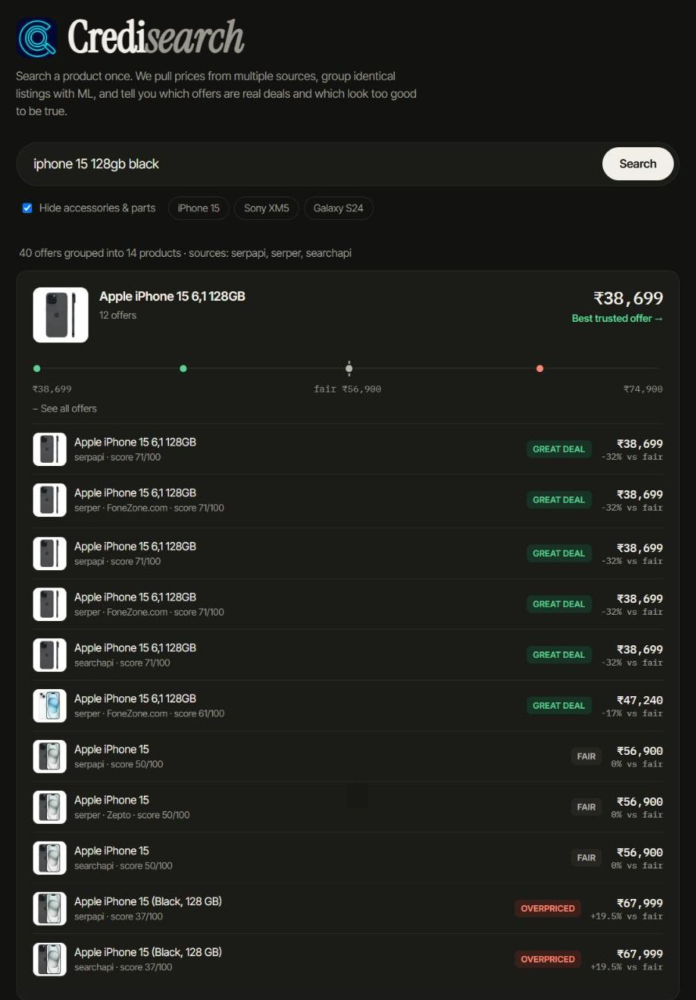
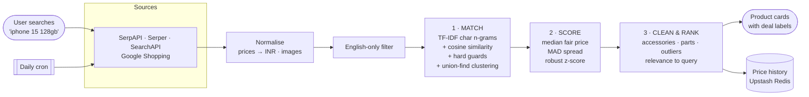
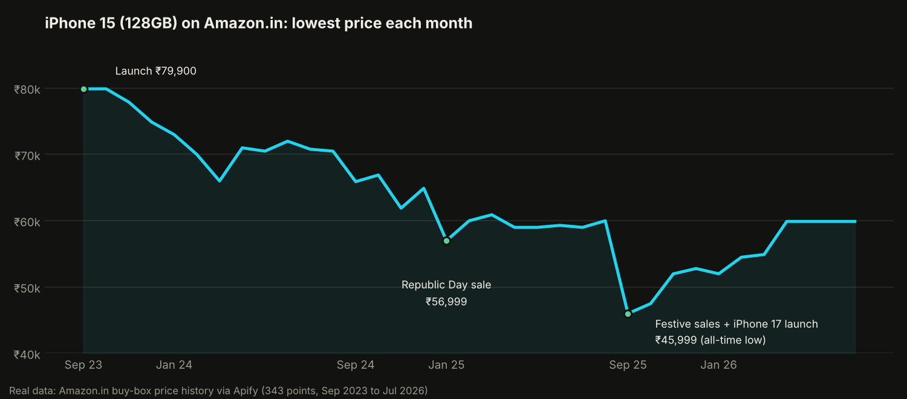

<p align="center">
  
</p>

<h1 align="center">Credisearch</h1>

<p align="center">
  <b>Search a product once. See the price you can actually trust.</b><br>
  A price-comparison engine that pulls offers from multiple sources, uses machine learning to group identical listings,<br>
  and flags which "deals" are real and which are too good to be true.
</p>

<p align="center">
  <a href="https://credisearchvercel.vercel.app"><b>🔗 Live demo</b></a> ·
  <a href="https://credisearchvercel.vercel.app/docs">API docs</a> ·
  <a href="ML.md">How the ML works</a> ·
  <a href="BACKEND.md">Backend deep-dive</a>
</p>

<p align="center">
  
  
  
  
  
  
</p>

<p align="center">
  
</p>

---

## The problem

Search for a phone on any shopping engine and you get a mess:

- **The same product, fifty different ways.** "Apple iPhone 15 (128 GB) - Black", "iPhone 15 128GB Blue" and "Apple iPhone 15, 128GB, Green" are one product at one price, but they show up as separate listings.
- **Look-alikes that aren't the same thing.** "iPhone 15" and "iPhone 15 **Pro**" are nearly identical as text but ₹50,000 apart.
- **Junk dressed up as a deal.** A ₹499 case, a ₹4,309 replacement display or a ₹21,999 "brand new sealed iPhone" (a scam) all sort to the top as the "cheapest iPhone".

Sorting by price is useless until you know **which listings are the same product** and **what a fair price for it is**. That's what Credisearch does.

## What it does

| | |
|---|---|
| 🔎 **Multi-source search** | Queries three Google Shopping APIs (SerpAPI, Serper, SearchAPI) and normalises every price to INR |
| 🧠 **ML product matching** | Groups identical listings across sellers and wordings, while keeping Pro/Plus/Max, storage sizes, generations and refurbished units apart |
| ⚖️ **Deal scoring** | Estimates a fair price per product with robust statistics and labels every offer **great deal · fair · overpriced · suspicious** with a 0–100 score |
| 🧹 **Junk removal** | Filters accessories, spare parts, "X for Y" add-ons, price outliers, non-English listings and off-topic results |
| 🛡️ **Best *trusted* offer** | The headline price skips suspicious listings, so a scam is never shown as the deal |
| 🖼️ **Image previews** | Every offer shows its product image, so you can see which colour each price is for |
| 📈 **Price history pipeline** | Logs a daily price per product (plus a daily job for tracked products) to power "buy now or wait" predictions |
| 🔌 **Built to survive free tiers** | A circuit breaker skips sources that run out of credits, one failing API never breaks a search, and responses are cached |

## How it works



### 1 · Match: which listings are the same product?
Each title is cleaned (colours, marketing words and spec numbers removed) and turned into a **TF-IDF vector of character n-grams**. Listings with high **cosine similarity** are clustered with **union-find**. On top of the statistics sit **hard guards**: two listings can only merge if their variant (Pro/Max/Plus/Mini…), storage, model number or code (S24 vs S23, XM5 vs XM4), condition (new vs refurbished) and kind (product vs accessory) all agree.

### 2 · Score: is this price good?
Within each product, the **median** is the fair price and the **median absolute deviation (MAD)** measures normal spread. Both resist outliers, so one fake listing can't move them. A **robust z-score** turns every price into a 0–100 deal score and a label. Anything under 55% of the fair price is marked **suspicious**.

<details>
<summary><b>Worked example</b> (six real-style iPhone 15 128GB offers)</summary>

| Offer | vs fair (₹68,700) | Label | Score |
|---|---|---|---|
| ₹21,999 | −68% | 🟠 suspicious | 20 |
| ₹65,999 | −3.9% | fair | 67 |
| ₹67,499 | −1.7% | fair | 57 |
| ₹69,900 | +1.7% | fair | 43 |
| ₹71,500 | +4.1% | fair | 33 |
| ₹79,999 | +16.4% | 🔴 overpriced | 0 |

The mean would be ₹62,816, dragged down by the scam. The median stays at ₹68,700. **Best trusted offer: ₹65,999.**
</details>

### 3 · Clean & rank
Accessories, spare parts and add-ons are flagged by word rules. A cross-product **price-outlier check** catches anything priced under 20% or over 5× the main product. Results are ranked by how closely they match the search: **exact → variant → other models**.

➡️ **Full explanation with formulas, design trade-offs and limitations: [ML.md](ML.md)**

## Real data: towards "buy now or wait"

Credisearch has a price-history pipeline built in. As a first test, one call to an Amazon.in price-history API returned **three years of real prices** for the iPhone 15:

<p align="center">
  
</p>

The patterns are clear: prices drop with **sale seasons** (Republic Day, the festive sales) and with **each new iPhone launch**. Next up is a model that learns these patterns and tells you whether to **buy now or wait**, with an explanation for each prediction.

## Tech stack

| Layer | Tools |
|---|---|
| Backend | Python 3.12, FastAPI, Pydantic v2, httpx |
| ML | Pure Python: TF-IDF, cosine similarity, union-find clustering, median/MAD robust statistics (no numpy or torch, so serverless cold starts stay fast) |
| Data sources | SerpAPI, Serper.dev, SearchAPI (Google Shopping); Apify for Amazon.in price history |
| Storage | Upstash Redis (price history and event log, over REST) |
| Frontend | Single-page vanilla HTML/CSS/JS served by FastAPI; mobile and dark mode |
| Infra | Vercel (serverless function + daily cron), GitHub auto-deploys |
| Quality | 24 pytest tests covering matching, scoring, outliers, the circuit breaker and the logger |

## API at a glance

```http
GET /search?q=iphone 15 128gb&limit=20&hide_accessories=true
```

```jsonc
{
  "groups": [{
    "name": "Apple iPhone 15 (128 GB)",
    "offers": 12, "median_price": 56900, "best_offer_price": 38699,
    "relevance": "exact", "suspicious_offers": 0, "history_key": "apple-iphone-15-128gb"
  }],
  "results": [{
    "title": "Apple iPhone 15 (Black, 128 GB)", "price": 67999, "source": "serpapi",
    "deal_label": "overpriced", "deal_score": 37, "vs_fair_pct": 19.5
  }],
  "sources_ok": ["serpapi", "serper", "searchapi"]
}
```

Other endpoints: `/history`, `/history/{key}`, `/history/events/recent`, `/health`. Interactive docs: [`/docs`](https://credisearchvercel.vercel.app/docs). Details: [BACKEND.md](BACKEND.md).

## Run it locally

```bash
git clone https://github.com/Atharva-Koli/Credisearch.git
cd Credisearch/backend
python -m venv venv && source venv/bin/activate   # Windows: venv\Scripts\activate
pip install -r requirements.txt
cp .env.example .env                               # add at least one API key
uvicorn app.main:app --reload                      # → http://localhost:8000
python -m pytest tests -q                          # run the tests (no keys needed)
```

Every source is optional, and one key is enough. See [`.env.example`](backend/.env.example) for the free tiers and [DEV.md](DEV.md) for deployment and troubleshooting.

## Project structure

```
backend/app/
├── main.py                 FastAPI app, UI and icons
├── api/routes/
│   ├── search.py           GET /search: fetch → filter → ML → log → respond
│   └── history.py          price history + daily cron
├── services/
│   ├── api_clients/        one client per price source
│   ├── aggregator.py       raw JSON → offers in INR
│   ├── source_health.py    circuit breaker for out-of-credit sources
│   ├── price_log.py        price history in Redis
│   └── ml/
│       ├── matcher.py      cleaning, TF-IDF, similarity, clustering, guards
│       ├── deal_scorer.py  median / MAD deal scoring
│       └── pipeline.py     groups, outliers, relevance, ranking
└── static/index.html       the UI
```

## Roadmap

- [x] Multi-source search with currency normalisation
- [x] ML product matching and deal scoring
- [x] Accessory, spare-part, outlier and non-English filtering
- [x] Circuit breaker, caching, fault-tolerant sources
- [x] Search UI with images, deal labels and price strips
- [x] Price-history logging and a daily tracking job
- [ ] Backfill years of Amazon.in history for tracked products
- [ ] **"Buy now or wait"** prediction, with an explanation for each prediction
- [ ] "Wrong match" feedback to collect labels and learn matching thresholds from data
- [ ] Price-drop alerts

## Documentation

| Doc | What's inside |
|---|---|
| [ML.md](ML.md) | The ML explained: matching, deal scoring, outlier removal, formulas, a worked example, trade-offs, limitations, interview Q&A |
| [BACKEND.md](BACKEND.md) | Request lifecycle, every module, data models, endpoints, sources, reliability, storage, cron, deployment |
| [DEV.md](DEV.md) | Running locally, environment variables, deploying, troubleshooting |

## Author

**Atharva Koli** · [GitHub @Atharva-Koli](https://github.com/Atharva-Koli)

Built as a personal project to explore applied ML, data pipelines and product thinking.

## License

[MIT](LICENSE)
